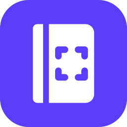
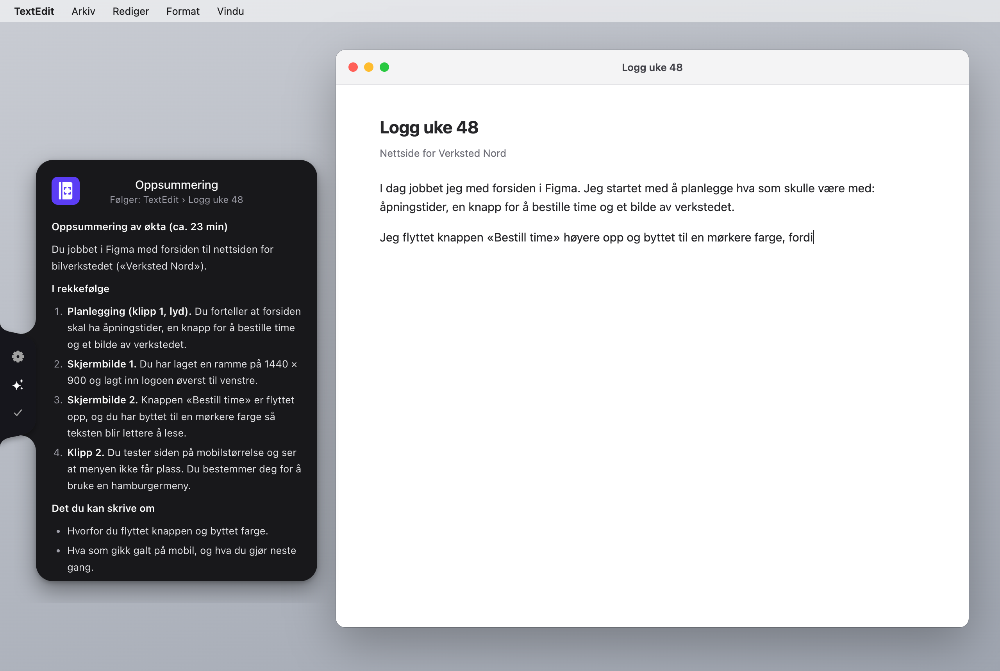
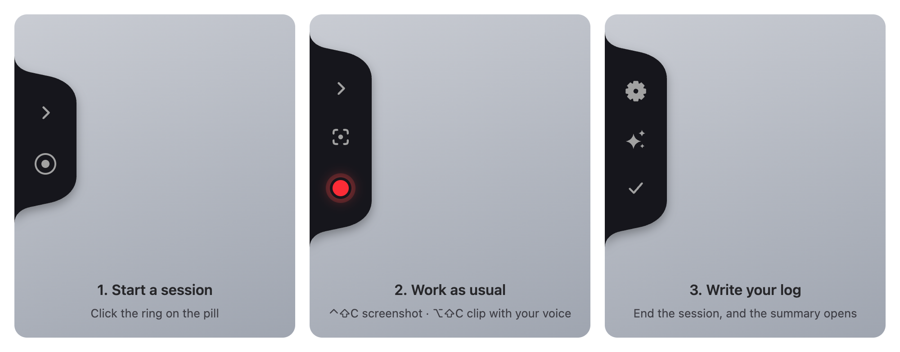

<p align="center">
  
</p>

<h1 align="center">Kladd</h1>

<p align="center">Records what you do on screen and helps you write your log about it. Everything stays on your Mac.</p>

<p align="center">
  
</p>

## How to use Kladd

Kladd is a small pill on the edge of your screen. Drag it to any edge you like.

<p align="center">
  
</p>

1. **Start a session** with the ring on the pill.
2. **Work as usual.** Press `⌃⇧C` for a screenshot, or `⌥⇧C` to record a clip and talk about what you are doing.
3. **End the session** with the red dot. Kladd writes a summary of what you did, using your own LLM key or subscription, and shows it beside the pill. Write your log from it, then press the checkmark.

## Development

```sh
pnpm install
pnpm dev            # UI dev server + Electron with rebuild on change
vp run check        # the full gate: format, lint, types, graph, tests
pnpm --filter @kladd/desktop package   # build a macOS app into apps/desktop/release
```

Architecture and conventions: [AGENTS.md](AGENTS.md).
